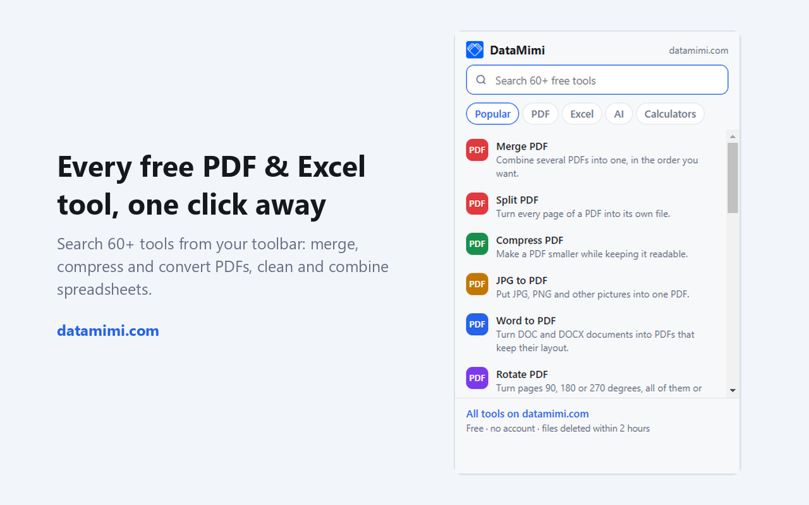
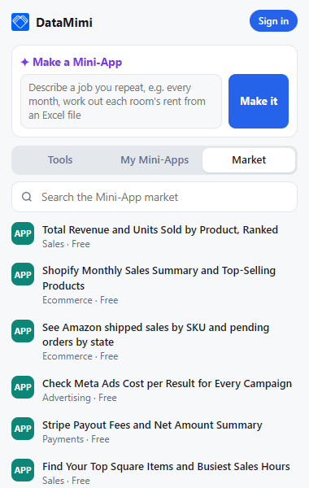

# DataMimi for Chrome

**Make a Mini-App from one sentence, and reach 60+ PDF and Excel tools from your toolbar.** The official Chrome extension for [DataMimi](https://datamimi.com/?utm_source=github&utm_medium=readme).

- **Make a Mini-App:** type a job you repeat ("every month, work out each room's rent from an Excel file") and press **Make it**. DataMimi opens its Mini-App maker with your words already in it.
- **My Mini-Apps:** signed in on datamimi.com, the popup lists your own apps, with your plan and credits; one click opens an app to run it.
- **Market:** browse and search the ready-made Mini-Apps.
- **Tools:** type what you need ("compress", "merge excel", "pdf to word"), or pick a popular tool. Right-click a link to a PDF or a spreadsheet and choose **Open with DataMimi**.

Everything opens on datamimi.com in a new tab. The PDF and Excel tools need no account and delete files within two hours.

## What you can do

**PDF:** [merge](https://datamimi.com/merge-pdf), [split](https://datamimi.com/split-pdf), [compress](https://datamimi.com/compress-pdf), [rotate](https://datamimi.com/rotate-pdf), [add page numbers](https://datamimi.com/add-page-numbers-to-pdf), [watermark](https://datamimi.com/watermark-pdf), [protect](https://datamimi.com/protect-pdf-with-password) or [unlock](https://datamimi.com/unlock-pdf). Convert [PDF to Word](https://datamimi.com/pdf-to-word) or [PDF to JPG](https://datamimi.com/pdf-to-jpg), and [Word](https://datamimi.com/word-to-pdf), [Excel](https://datamimi.com/excel-to-pdf), [PowerPoint](https://datamimi.com/powerpoint-to-pdf) or [images](https://datamimi.com/jpg-to-pdf) to PDF.

**Excel and CSV:** [merge Excel files](https://datamimi.com/tools/merge-excel-files), [join two files on a column (VLOOKUP)](https://datamimi.com/tools/merge-two-excel-files-by-column), [remove duplicates](https://datamimi.com/tools/remove-duplicates-excel), [clean a messy sheet](https://datamimi.com/tools/clean-messy-spreadsheet), [pivot tables](https://datamimi.com/tools/pivot-table-online), [split a file](https://datamimi.com/tools/split-excel-file), [CSV to Excel](https://datamimi.com/tools/convert-csv-to-excel), [JSON to Excel](https://datamimi.com/tools/json-to-excel), and [a dashboard from a spreadsheet](https://datamimi.com/tools/free-dashboard-from-excel). Each one is also a Mini-App you can keep and change.

**More:** [business calculators](https://datamimi.com/calculators), the [Mini-App maker](https://datamimi.com/make), and an [AI analyst](https://datamimi.com/ai) that answers questions about your spreadsheet.

The extension works in English, Español, Português, Français, Deutsch, Bahasa Indonesia, Tiếng Việt and 日本語: your browser's language at first, or the one you pick with the globe button in the popup.

## Privacy

- **Permissions:** `contextMenus` for the right-click menu, `storage` to remember the language chosen in the popup, and access to `datamimi.com` only.
- **What it asks datamimi.com:** when the popup opens, it reads the Mini-App market, and, with the cookies you already have on datamimi.com, whether you are signed in, your plan, credits and the list of your Mini-Apps. It reads nothing from other sites and nothing from the pages you visit.
- **What it sends:** nothing, until you press **Make it**: then the sentence you typed opens on datamimi.com in a new tab.
- **No remote code:** the code ships in the extension; only data is fetched.
- Links it opens carry `utm_source=chrome-extension`, so DataMimi can count visits that came from the extension. That is the only tracking.

Full policy: [datamimi.com/legal/privacy](https://datamimi.com/legal/privacy)

## Install from source

1. Download this repository (Code → Download ZIP) and unzip it.
2. Open `chrome://extensions` and turn on **Developer mode**.
3. Click **Load unpacked** and choose the unzipped folder.

## Files

| File | What it is |
|---|---|
| `manifest.json` | Manifest V3: the popup, the service worker, the right-click permission and datamimi.com |
| `popup.html`, `popup.css`, `popup.js` | The popup: the Mini-App maker, your Mini-Apps, the market and the tool finder |
| `background.js` | The right-click menu |
| `strings.js` | The words in eight languages |
| `tools.js` | The tool list, generated from datamimi.com |
| `_locales/` | The name and description in each language |

## Feedback

Found a bug, or want a tool added? [Open an issue](../../issues) or use the contact options on [datamimi.com](https://datamimi.com/about).

---

Made by [DataMimi](https://datamimi.com/?utm_source=github&utm_medium=readme): PDF, Excel and Mini-App tools, plus an AI data analyst.
